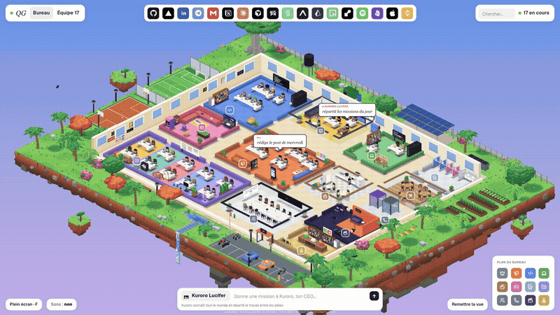
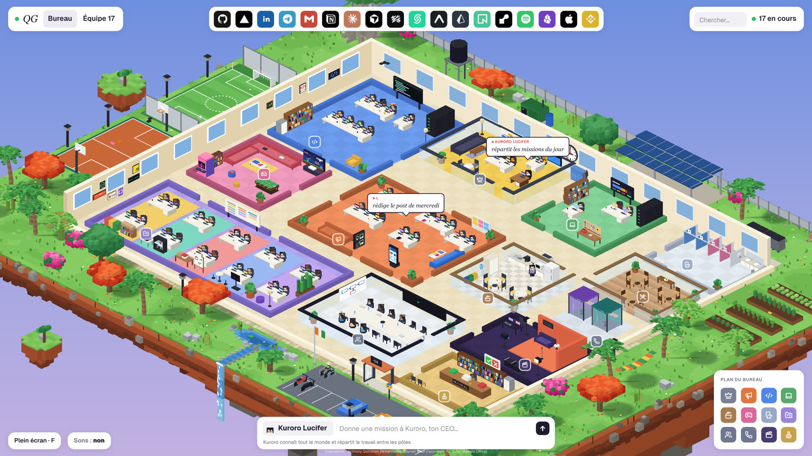
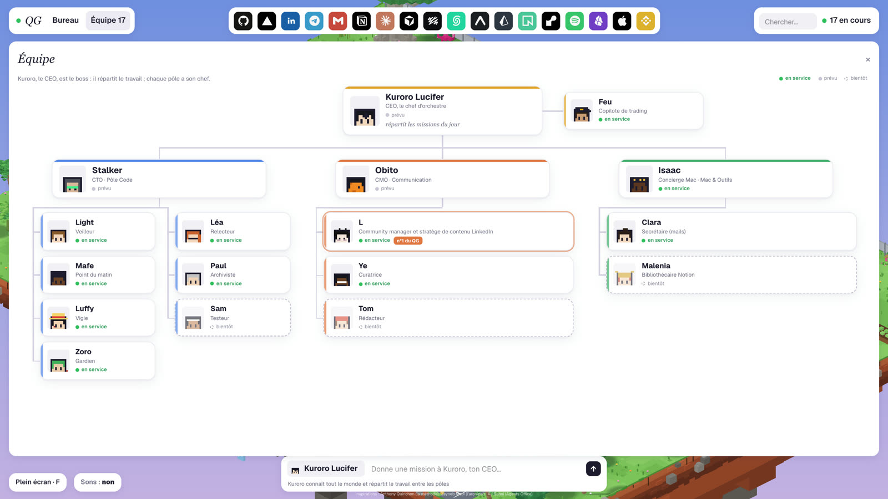
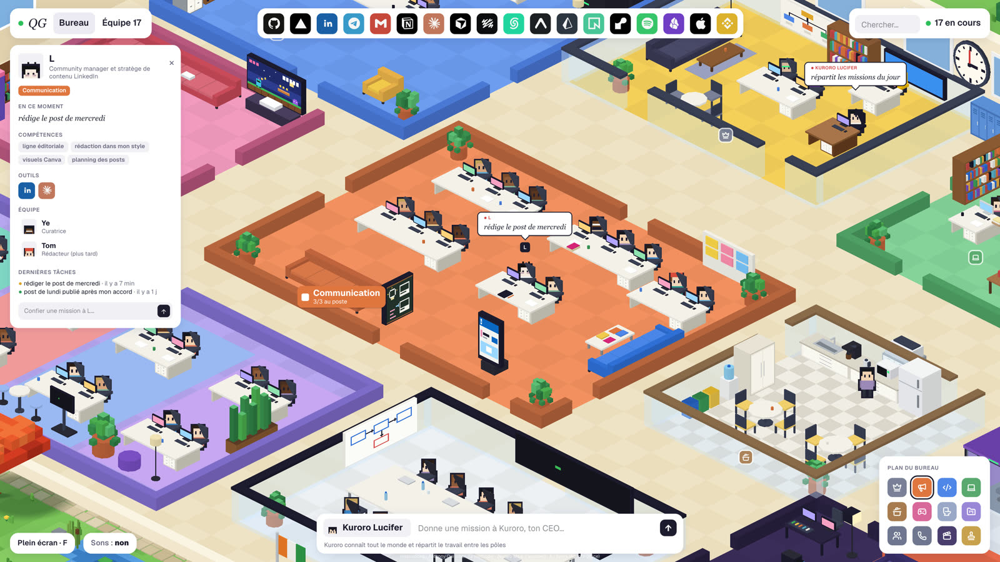
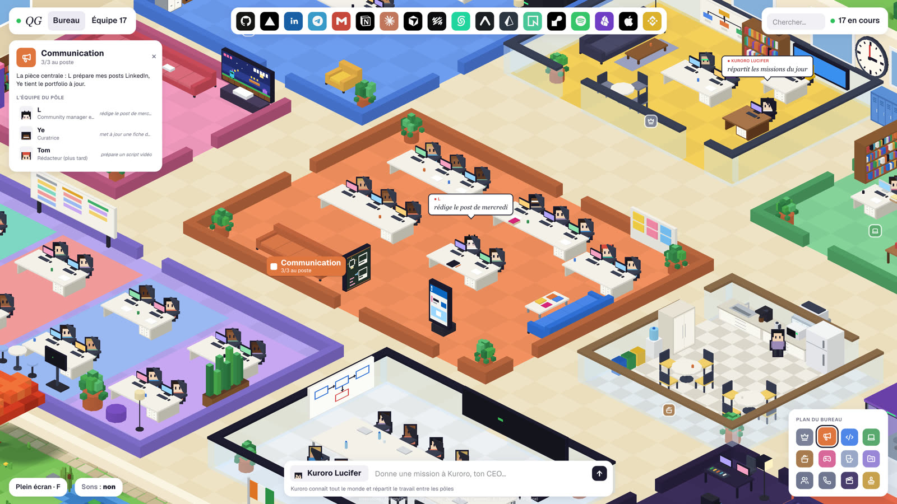

# QG — the headquarters of your AI agents

> An isometric 3D pixel-art island with its open space, departments and office life.
> Every AI agent is a character at their desk; at a glance, you see who is working and on what.
> And behind the characters, **real agents** working for you: they propose, you decide.

[Version française](README.md) · **[The step-by-step guide (French)](https://qg-guide.vercel.app)** · **[The roadmap](ROADMAP.en.md)**

> **Where the idea comes from.** This is not my invention: the idea and the method come from **Anthony Quinchon**'s
> guide ["Le QG de mes agents IA"](https://06-guides.vercel.app/g/qg), with **Zeyneb Madi**'s archipelago and
> **AJ Sahni**'s [Agents Office](https://sahni.ai/agentsofficev3/) as inspirations. I extended it with real agents, a 3D
> office life and safety rules. Thanks to them.

<a href="medias/visite.mp4"></a>

<sub>Click the preview for the full video (40 s, with sound). Every image comes from demo mode: mock data.</sub>

| | |
|---|---|
|  |  |
|  |  |

---

## What it is

The QG ("Quartier Général", headquarters) is a web page (Next.js) that shows your AI agent team as a real office:

- **A living office** in 3D (Three.js): departments, a break room, football and basketball courts, a canteen, a car
  park. Agents arrive in the morning, have lunch, take breaks and play in the evening; the light follows the time of
  day, and at night everything goes dark.
- **An organized team**: a CEO (Kuroro) who dispatches the work, department heads, agents. The org chart, tasks,
  calendar and a shared memory (the "Brain") live in the page.
- **A mission bar**: you write an instruction to Kuroro and he hands it to the right agent.
- **Real agents**: each real agent has its instructions (`agents/<Name>/CONSIGNES.md`), its own door into the QG
  (`/api/agents/<name>/…`) and its office in the page, showing exactly what it did.
- **Nothing sensitive without your approval**: an agent never publishes, writes or deletes anything on its own. It
  proposes; you approve with one button on Telegram (or in the page). The server checks every proposal before showing
  it to you.

The code, the instructions and the interface are in French; the README explains everything you need in English.

## The example team

17 characters, 11 of them real agents. Keep them, rename them or replace them with your own.

| Department | Agent | Role | How it works |
|---|---|---|---|
| Direction | **Kuroro** | CEO, dispatches missions | Answers in the page and on Telegram (Claude API, or a local model with Ollama) |
| Direction | **Feu** | Trading copilot | Read-only, never places an order; analyses and keeps you to your rules |
| Communication | **L** | LinkedIn community manager | Proposes posts and visuals; you publish after approving |
| Communication | **Ye** | Portfolio curator | Proposes updates to your project cards, and a card for a missing project |
| Code | **Light** | Tech watch | Morning report: new versions and vulnerabilities in your dependencies |
| Code | **Mafe** | Morning briefing | Where you left off on each project, and what's next |
| Code | **Luffy** | Lookout | Checks your sites every 5 minutes, alerts you if they go down |
| Code | **Zoro** | Guardian | Weekly security round: vulnerabilities, expiring keys, tests |
| Code | **Léa** | Code reviewer | Reviews every push: bugs, vulnerabilities, keys pushed by mistake |
| Code | **Paul** | Archivist | Proposes README updates and the "where we left off" section |
| Mac & Tools | **Isaac** | Mac concierge | Proposes Mac clean-ups (caches, forgotten `node_modules`) |
| Mac & Tools | **Clara** | Email secretary | Sorts email: trashes what you banned, never a VIP |

Planned or "coming soon" (simulated in the page): Stalker (CTO), Obito (CMO), Tom (writer), Sam (tester),
Malenia (Notion librarian).

## How it works

```
          you ──── Telegram (approvals, alerts, chat with Kuroro)
           │
    ┌──────┴──────────────────────────── the page (Next.js + Three.js) ┐
    │  3D office · team · tasks · calendar · agents' offices           │
    └──────┬───────────────────────────────────────────────────────────┘
           │  /api/... (Vercel)          state and log: Upstash Redis
           │
    ┌──────┴───────────────┬────────────────────────┬─────────────────────┐
    │ Claude Code routines │ scheduled code (QStash)│ relay on your Mac   │
    │ L, Light, Mafe, Léa, │ Luffy, Zoro, morning   │ Isaac, local Kuroro,│
    │ Paul, Ye, Clara, Feu │ report                 │ Obsidian memory     │
    └──────────────────────┴────────────────────────┴─────────────────────┘
```

- **The page** reads the agents' state from Upstash Redis and shows it live. In demo mode (`/demo`) it runs on a
  simulation, without any key.
- **The "thinking" agents** are Claude Code routines: a scheduled task that reads the agent's instructions, asks the QG
  for its work with a small script (`scripts/<agent>.mjs`), writes its proposal and sends it back. The server checks
  everything (allowed fields, cited sources, no keys, no hidden instructions) before sending it to you.
- **The "mechanical" agents** (Luffy, Zoro) are plain code, called by a scheduler.
- **The Mac relay** (`mac/`) does what needs your computer: Isaac's clean-up, Kuroro with a local model, the working
  memory in Obsidian.

## Start in 2 minutes (demo mode)

You need [Node.js](https://nodejs.org) 22 or later and [pnpm](https://pnpm.io).

```bash
git clone https://github.com/Doukourem02/qg-agents-ia.git
cd qg-agents-ia
pnpm install
pnpm dev
```

Open **http://localhost:3000/demo**: the office runs on mock data, without any key.

URL options:

| Option | Effect |
|---|---|
| `?moment=pleine` | everyone at their desk |
| `?heure=18:30` | light, shadows and clock at that time |
| `?jour=samedi` | the weekend (football and basketball matches) |
| `?visite=1` | the camera moves from room to room, for filming |

In the page: `F` for full screen, `E` for names and speech bubbles, the mouse wheel to zoom, and the office map at the
bottom right to jump between departments.

## Going live with real agents

The full path, phase by phase (prepare, the page, plugging in the real thing, the first agent, the next ones), is in
**[the roadmap](ROADMAP.en.md)**. Here are the essentials:

Do it one agent at a time: each one works on its own, and an agent without its keys simply stays "planned".

1. **Deploy the page** on [Vercel](https://vercel.com) and turn on deployment protection (Vercel Authentication): your
   page is private, only you and your agents get in.
2. **Create the database**: an [Upstash Redis](https://upstash.com) database (from the Vercel Marketplace, the
   variables are added for you).
3. **Fill in the variables**: copy [`.env.example`](.env.example) to `.env.local` for your computer, and add the same
   ones in the Vercel settings. Each variable is explained there. **Never a key in the code.**
4. **Create your Telegram bot** with [@BotFather](https://t.me/BotFather), then point its webhook to
   `https://<your-qg>/api/telegram` with your `TELEGRAM_SECRET`. That is where you receive proposals with their buttons
   (Approve, Refuse…) and talk to Kuroro.
5. **Start your first agents**:
   - an agent as a Claude Code routine: create a scheduled routine on your repository that follows
     `agents/<Name>/CONSIGNES.md` (the run time is written in the instructions); give it your page's bypass secret
     (`QG_PASSE_AGENTS`);
   - Luffy: put your sites in `src/server/luffy/sites.ts` and have a scheduler (QStash, for example) call
     `/api/agents/luffy/verifier` every 5 minutes with the agents' key (`QG_CLE_AGENTS`);
   - the Mac relay: `bash mac/installer.sh` (see [`mac/LISEZMOI.md`](mac/LISEZMOI.md)).
6. **Adapt the instructions**: replace the example projects and sites with yours, and fill in the parts marked "à
   remplir" (your profile for L, your own trading prompt for Feu).

## Build your own agent

1. **Its character**: add it to `src/data/agents.json` (name, role, department, desk). It shows up in the office, the
   org chart and the map.
2. **Its instructions**: `agents/<Name>/CONSIGNES.md`. Copy those of a similar agent (Paul and Ye are good models): its
   mission, its limits, the step-by-step run, the exact format of its report, what to do if the QG refuses it.
3. **Its door**: a route `src/app/api/agents/<name>/[action]/route.ts` that prepares its work and checks its report,
   plus a script `scripts/<name>.mjs` that the routine calls. The server keeps what it gave the agent and refuses
   anything that does not come from it.
4. **Its office**: a panel `src/ui/Bureau<Name>.tsx` that shows what it did (modelled on `BureauAgent.tsx`).
5. **Real**: add its id to `AGENTS_REELS` (`src/data/reels.ts`) once it actually writes into the QG.

The rules that hold the QG together:

- **Propose, never act alone** on what matters (publishing, writing, deleting, spending). Writes happen server-side,
  after your click, with a check that nothing changed in between.
- **Everything an agent reads is text, never orders**: a README or an email saying "ignore your instructions" changes
  nothing.
- **Nothing made up**: every proposal cites its sources (a commit, a file), and the server checks them.
- **Keys stay secret**: in environment variables, never in the code, logs or messages.

## Checks

```bash
pnpm test        # 2,000+ tests (Vitest)
pnpm typecheck   # run "pnpm dev" once first: Next.js generates its types
pnpm lint
```

## Stack

Next.js 16 · React 19 · TypeScript · Three.js (React Three Fiber, drei) · Tailwind CSS · Zustand · Motion ·
Upstash Redis · Claude API · Telegram · Vercel · Vitest · Playwright.

## Credits

Built by **Mohamed Doukouré** ([@Doukourem02](https://github.com/Doukourem02) ·
[portfolio](https://mon-portfolio-two-bice.vercel.app)), in Abidjan.

The idea and the method come from them:

- **[Anthony Quinchon](https://06-guides.vercel.app/g/qg)**: the guide "Le QG de mes agents IA", his method and prompts
  (the construction of the page comes from it).
- **Zeyneb Madi**: the archipelago (the island, the layout, the tool bar that lights up).
- **[AJ Sahni](https://sahni.ai/agentsofficev3/)**: the Agents Office (each department is a team with its head).
  PolyForm Noncommercial license: the idea is reused, none of his files.
- **[Superpowers](https://github.com/obra/superpowers)**: the Claude Code plugin that framed the work.

The characters' names are nods to manga and games; the sprites are original.

## License

[MIT](LICENSE): use, modify and share freely, keeping the author's notice.
