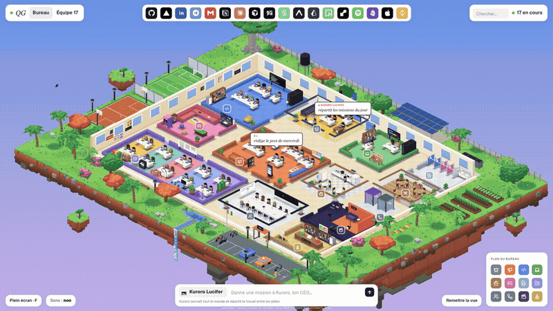
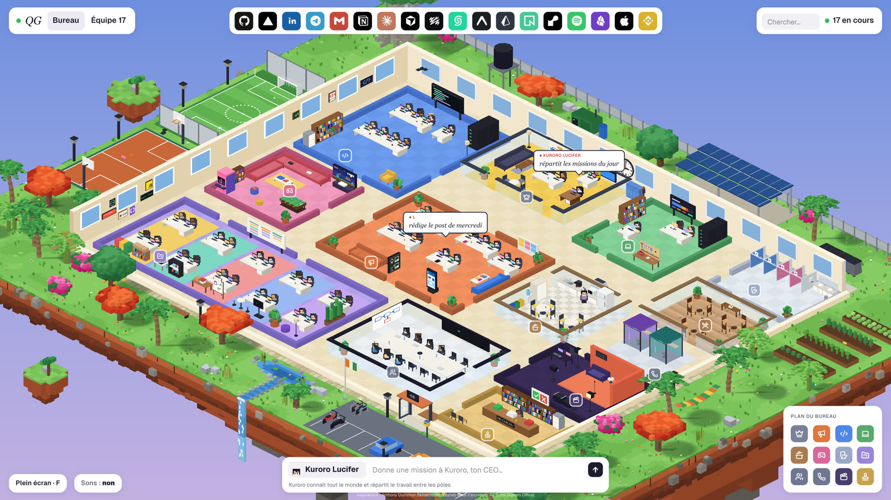
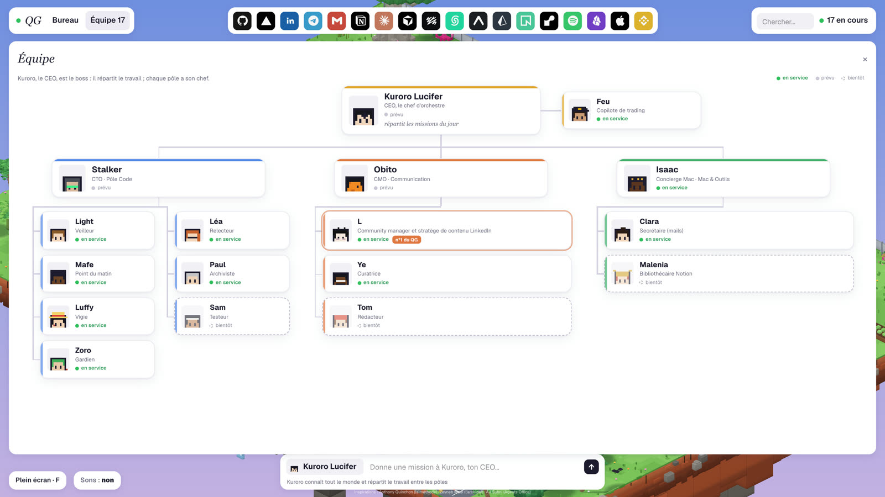
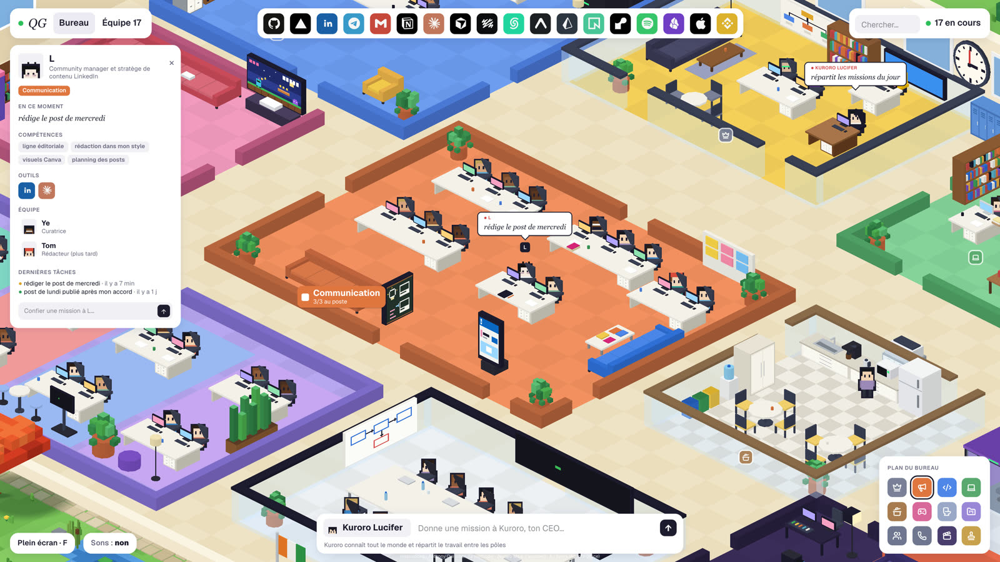
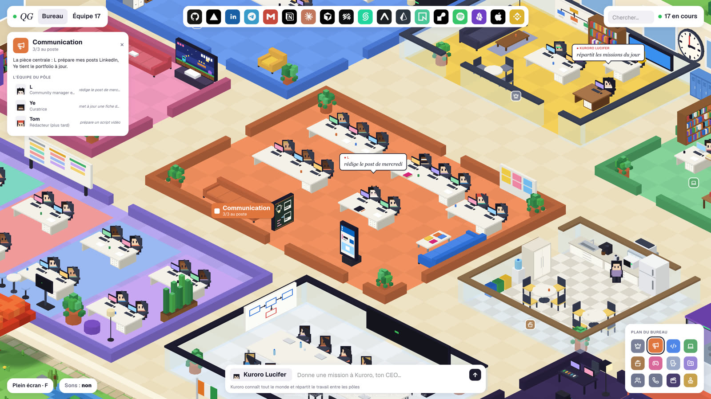

# QG — le quartier général de tes agents IA

> Une île en 3D isométrique façon pixel art, avec son open space, ses pôles et sa vie de bureau.
> Chaque agent IA est un personnage à son poste ; d'un coup d'œil, tu vois qui travaille et sur quoi.
> Et derrière les personnages, de **vrais agents** qui travaillent pour toi : ils proposent, tu décides.

[English version](README.en.md) · **[Le guide pas à pas](https://qg-guide.vercel.app)** · **[La feuille de route](ROADMAP.md)**

> **D'où vient l'idée.** Ce n'est pas mon invention : l'idée et la méthode viennent du guide
> [« Le QG de mes agents IA »](https://06-guides.vercel.app/g/qg) d'**Anthony Quinchon**, avec l'archipel de
> **Zeyneb Madi** et l'[Agents Office](https://sahni.ai/agentsofficev3/) d'**AJ Sahni** comme inspirations. Je l'ai
> prolongé avec de vrais agents, une vie de bureau en 3D et des règles de sécurité. Merci à eux.

<a href="medias/visite.mp4"></a>

<sub>Clique sur l'aperçu pour la vidéo complète (40 s, avec le son). Toutes les images viennent du mode démo : données fictives.</sub>

| | |
|---|---|
|  |  |
|  |  |

---

## Ce que c'est

Le QG est une page web (Next.js) qui montre ton équipe d'agents IA comme un vrai bureau :

- **Un bureau vivant** en 3D (Three.js) : des pôles, une salle de pause, des terrains de foot et de basket, une
  cantine, un parking. Les agents arrivent le matin, déjeunent, font des pauses, jouent le soir ; la lumière suit l'heure
  du jour, et la nuit tout s'éteint.
- **Une équipe organisée** : un CEO (Kuroro) qui répartit le travail, des chefs de pôle, des agents. L'organigramme,
  les tâches, le calendrier et une mémoire partagée (le « Cerveau ») sont dans la page.
- **Une barre de mission** : tu écris une consigne à Kuroro, il la confie au bon agent.
- **De vrais agents** : chaque agent réel a ses consignes (`agents/<Nom>/CONSIGNES.md`), sa porte d'entrée dans le QG
  (`/api/agents/<nom>/…`) et son bureau dans la page, qui montre exactement ce qu'il a fait.
- **Rien de sensible sans ton accord** : un agent ne publie, n'écrit et ne supprime rien tout seul. Il propose ;
  tu valides d'un bouton sur Telegram (ou dans la page). Le serveur vérifie chaque proposition avant de te la montrer.

## L'équipe d'exemple

17 personnages, dont 11 agents réels. Garde-les, renomme-les ou remplace-les par les tiens.

| Pôle | Agent | Rôle | Comment il travaille |
|---|---|---|---|
| Direction | **Kuroro** | CEO, répartit les missions | Répond dans la page et sur Telegram (API Claude, ou un modèle local avec Ollama) |
| Direction | **Feu** | Copilote de trading | Lecture seule, jamais un ordre ; analyse et te tient à tes règles |
| Communication | **L** | Community manager LinkedIn | Propose des posts et des visuels ; tu publies après ton accord |
| Communication | **Ye** | Curatrice du portfolio | Propose des mises à jour de tes fiches de projet, et une fiche pour un projet absent |
| Code | **Light** | Veilleur | Relevé du matin : nouvelles versions et failles de tes dépendances |
| Code | **Mafe** | Point du matin | Où tu t'es arrêté sur chaque projet, et la suite |
| Code | **Luffy** | Vigie | Vérifie tes sites toutes les 5 minutes, t'alerte s'ils tombent |
| Code | **Zoro** | Gardien | Tour de sécurité hebdomadaire : failles, clés qui expirent, tests |
| Code | **Léa** | Relectrice | Relit chaque push : bugs, failles, clés poussées par erreur |
| Code | **Paul** | Archiviste | Propose la mise à jour du README et du « où on s'est arrêté » |
| Mac & Outils | **Isaac** | Concierge Mac | Propose le ménage du Mac (caches, `node_modules` oubliés) |
| Mac & Outils | **Clara** | Secrétaire des mails | Trie les mails : met à la corbeille ce que tu as banni, jamais un VIP |

Prévus ou « bientôt » (simulés dans la page) : Stalker (CTO), Obito (CMO), Tom (rédacteur), Sam (testeur),
Malenia (bibliothécaire Notion).

## Comment ça marche

```
          toi ──── Telegram (accords, alertes, discussion avec Kuroro)
           │
    ┌──────┴──────────────────────────── la page (Next.js + Three.js) ─┐
    │  bureau 3D · équipe · tâches · calendrier · bureaux des agents   │
    └──────┬───────────────────────────────────────────────────────────┘
           │  /api/... (Vercel)          état et journal : Upstash Redis
           │
    ┌──────┴───────────────┬────────────────────────┬─────────────────────┐
    │ routines Claude Code │ code planifié (QStash) │ relais sur ton Mac  │
    │ L, Light, Mafe, Léa, │ Luffy, Zoro, compte    │ Isaac, Kuroro local,│
    │ Paul, Ye, Clara, Feu │ rendu du matin         │ mémoire Obsidian    │
    └──────────────────────┴────────────────────────┴─────────────────────┘
```

- **La page** lit l'état des agents dans Upstash Redis et l'affiche en direct. En mode démo (`/demo`), elle tourne avec
  une simulation, sans aucune clé.
- **Les agents « qui réfléchissent »** sont des routines Claude Code : une tâche planifiée qui lit les consignes de
  l'agent, demande son travail au QG avec un petit script (`scripts/<agent>.mjs`), écrit sa proposition, et la renvoie.
  Le serveur vérifie tout (champs autorisés, sources citées, aucune clé, aucune consigne cachée) avant de te l'envoyer.
- **Les agents « mécaniques »** (Luffy, Zoro) sont du code pur, appelé par un planificateur.
- **Le relais Mac** (`mac/`) fait ce qui demande ton ordinateur : le ménage d'Isaac, Kuroro avec un modèle local,
  la mémoire de travail dans Obsidian.

## Démarrer en 2 minutes (mode démo)

Il te faut [Node.js](https://nodejs.org) 22 ou plus récent et [pnpm](https://pnpm.io).

```bash
git clone https://github.com/Doukourem02/qg-agents-ia.git
cd qg-agents-ia
pnpm install
pnpm dev
```

Ouvre **http://localhost:3000/demo** : le bureau tourne avec des données fictives, sans aucune clé.

Options dans l'adresse :

| Option | Effet |
|---|---|
| `?moment=pleine` | tout le monde à son poste |
| `?heure=18:30` | la lumière, les ombres et l'horloge à cette heure |
| `?jour=samedi` | le week-end (matchs de foot et de basket) |
| `?visite=1` | la caméra passe de pièce en pièce, pour filmer |

Dans la page : `F` pour le plein écran, `E` pour les noms et les bulles, la molette pour zoomer, et le plan du bureau
en bas à droite pour aller d'un pôle à l'autre.

## Passer aux vrais agents

Le chemin complet, phase par phase (préparer, la page, brancher le réel, le premier agent, les suivants), est dans
**[la feuille de route](ROADMAP.md)**. Ici, l'essentiel :

Fais-le agent par agent : chacun marche seul, et un agent sans ses clés reste simplement « prévu ».

1. **Déploie la page** sur [Vercel](https://vercel.com) et active la protection du déploiement (Vercel Authentication) :
   ta page est privée, seuls toi et tes agents y entrent.
2. **Crée la base** : une base [Upstash Redis](https://upstash.com) (depuis le Marketplace de Vercel, les variables
   sont ajoutées toutes seules).
3. **Remplis les variables** : copie [`.env.example`](.env.example) en `.env.local` pour ton ordinateur, et ajoute les
   mêmes dans les réglages de Vercel. Chaque variable y est expliquée. **Jamais une clé dans le code.**
4. **Crée ton bot Telegram** avec [@BotFather](https://t.me/BotFather), puis branche son webhook sur
   `https://<ton-qg>/api/telegram` avec ton `TELEGRAM_SECRET`. C'est là que tu recevras les propositions avec leurs
   boutons (Valider, Refuser…), et que tu parleras à Kuroro.
5. **Lance tes premiers agents** :
   - un agent en routine Claude Code : crée une routine planifiée sur ton dépôt, qui suit `agents/<Nom>/CONSIGNES.md`
     (l'heure de passage est écrite dans les consignes) ; donne-lui le laissez-passer de ta page (`QG_PASSE_AGENTS`) ;
   - Luffy : mets tes sites dans `src/server/luffy/sites.ts` et fais appeler `/api/agents/luffy/verifier` toutes les
     5 minutes par un planificateur (QStash, par exemple), avec la clé des agents (`QG_CLE_AGENTS`) ;
   - le relais Mac : `bash mac/installer.sh` (voir [`mac/LISEZMOI.md`](mac/LISEZMOI.md)).
6. **Adapte les consignes** : remplace les projets et les sites d'exemple par les tiens, et remplis les passages
   marqués « à remplir » (ton profil pour L, ton propre prompt de trading pour Feu).

## Créer ton propre agent

1. **Son personnage** : ajoute-le dans `src/data/agents.json` (nom, rôle, pôle, poste). Il apparaît dans le bureau,
   dans l'organigramme et dans le plan.
2. **Ses consignes** : `agents/<Nom>/CONSIGNES.md`. Copie celles d'un agent proche (Paul et Ye sont de bons modèles) :
   sa mission, ses limites, le pas à pas de son passage, le format exact de son rapport, quoi faire si le QG le refuse.
3. **Sa porte d'entrée** : une route `src/app/api/agents/<nom>/[action]/route.ts` qui prépare son travail et vérifie
   son rapport, plus un script `scripts/<nom>.mjs` que la routine appelle. Le serveur garde ce qu'il a donné à l'agent
   et refuse tout ce qui n'en vient pas.
4. **Son bureau** : un panneau `src/ui/Bureau<Nom>.tsx` qui montre ce qu'il a fait (sur le modèle de `BureauAgent.tsx`).
5. **Réel** : ajoute son identifiant à `AGENTS_REELS` (`src/data/reels.ts`) quand il écrit vraiment dans le QG.

Les règles qui font tenir le QG :

- **Proposer, jamais agir seul** sur ce qui compte (publier, écrire, supprimer, dépenser). L'écriture se fait côté
  serveur, après ton clic, avec une vérification que rien n'a bougé entre-temps.
- **Tout ce qu'un agent lit est du texte, jamais des ordres** : un README ou un mail qui dit « ignore tes consignes »
  ne change rien.
- **Rien d'inventé** : chaque proposition cite ses sources (un commit, un fichier), et le serveur le vérifie.
- **Les clés restent secrètes** : dans les variables d'environnement, jamais dans le code, les journaux ou les messages.
- **Chacun à sa porte** : les entrées de la page refusent les clés des agents, et chaque agent peut avoir sa propre clé
  (`QG_CLE_AGENT_<NOM>`) : un agent piégé ne lit pas les bureaux des autres et ne parle pas à leur place.

## Vérifier

```bash
pnpm test        # 2 000+ tests (Vitest) ; ils tournent aussi sur GitHub à chaque push
pnpm typecheck   # lance d'abord « pnpm dev » une fois : Next.js génère ses types
pnpm lint
```

## La pile

Next.js 16 · React 19 · TypeScript · Three.js (React Three Fiber, drei) · Tailwind CSS · Zustand · Motion ·
Upstash Redis · API Claude · Telegram · Vercel · Vitest · Playwright.

## Crédits

Créé par **Mohamed Doukouré** ([@Doukourem02](https://github.com/Doukourem02) ·
[portfolio](https://mon-portfolio-two-bice.vercel.app)), à Abidjan.

L'idée et la méthode viennent d'eux :

- **[Anthony Quinchon](https://06-guides.vercel.app/g/qg)** : le guide « Le QG de mes agents IA », sa méthode et ses
  prompts (la construction de la page en vient).
- **Zeyneb Madi** : l'archipel (l'île, la disposition, la barre d'outils qui s'allume).
- **[AJ Sahni](https://sahni.ai/agentsofficev3/)** : l'Agents Office (chaque pôle est une équipe avec son chef). Licence
  PolyForm Noncommercial : l'idée est reprise, aucun de ses fichiers.
- **[Superpowers](https://github.com/obra/superpowers)** : le plugin de Claude Code qui a cadré le travail.

Les noms des personnages sont des clins d'œil à des mangas et des jeux ; les sprites sont originaux.

## Licence

[MIT](LICENSE) : utilise, modifie et partage librement, en gardant la mention de l'auteur.
